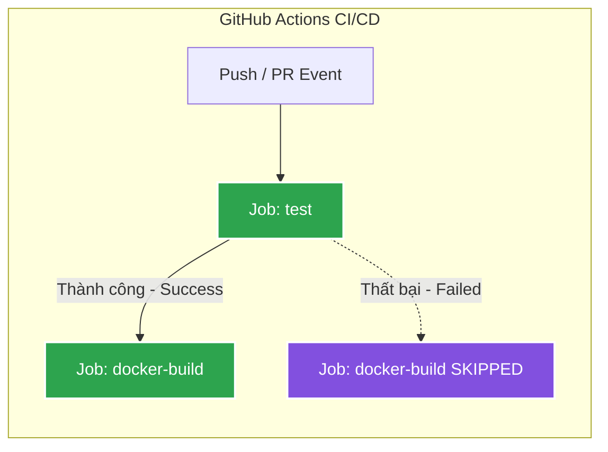

# BÀI TẬP 5: NỐI JOB TỰ ĐỘNG BUILD & PUSH DOCKER IMAGE SAU KHI TEST GRADLE XANH

## 1. Mục tiêu bài tập
- **Phân tách luồng CI/CD**: Chia workflow thành 2 Jobs riêng biệt với trách nhiệm độc lập:
  - **Job `test`**: Thực hiện kiểm thử tự động với Gradle và đóng gói mã nguồn thành tệp JAR.
  - **Job `docker-build`**: Đăng nhập GitHub Container Registry (`ghcr.io`), đóng gói Docker Image từ `Dockerfile` và đẩy (push) lên registry.
- **Ràng buộc phụ thuộc (`needs`)**: Sử dụng từ khóa `needs: test` để tạo biểu đồ phụ thuộc (DAG - Directed Acyclic Graph), đảm bảo rằng hình ảnh Docker chỉ được đóng gói khi và chỉ khi toàn bộ các bài kiểm thử JUnit thành công (trạng thái màu xanh).

---

## 2. Biểu đồ luồng thực thi (Workflow Graph)



Khi quan sát trên tab **Actions** của GitHub, một mũi tên trực quan sẽ xuất hiện nối từ Job **Run Gradle Tests & Package JAR (`test`)** sang Job **Build and Push Docker Image (`docker-build`)**.

---

## 3. Nội dung tệp cấu hình `.github/workflows/ci.yml`

```yaml
name: CI/CD Pipeline - Test & Docker Build

on:
  push:
    branches: [ "main", "master" ]
  pull_request:
    branches: [ "main", "master" ]
  workflow_dispatch:

jobs:
  # =========================================================================
  # JOB 1: Kiểm thử mã nguồn và đóng gói JAR
  # =========================================================================
  test:
    name: Run Gradle Tests & Package JAR
    runs-on: ubuntu-latest

    steps:
      - name: Checkout mã nguồn
        uses: actions/checkout@v4

      - name: Thiết lập môi trường Java JDK 17
        uses: actions/setup-java@v5
        with:
          java-version: '17'
          distribution: 'temurin'
          cache: 'gradle'

      - name: Cấp quyền thực thi cho Gradle Wrapper
        run: chmod +x gradlew

      - name: Thực thi kiểm thử và đóng gói JAR
        run: ./gradlew test bootJar --no-daemon

  # =========================================================================
  # JOB 2: Đóng gói và đẩy Docker Image lên GHCR (Phụ thuộc vào JOB 1)
  # =========================================================================
  docker-build:
    name: Build and Push Docker Image
    needs: test # CHỈ CHẠY KHI JOB test HOÀN THÀNH THÀNH CÔNG (MÀU XANH)
    runs-on: ubuntu-latest

    steps:
      - name: Checkout mã nguồn
        uses: actions/checkout@v4

      - name: Đăng nhập vào GitHub Container Registry
        uses: docker/login-action@v3
        with:
          registry: ghcr.io
          username: ${{ github.actor }}
          password: ${{ secrets.REGISTRY_TOKEN }}

      - name: Đóng gói và đẩy Docker Image lên GHCR
        uses: docker/build-push-action@v5
        with:
          context: .
          file: ./Dockerfile
          push: true
          tags: |
            ghcr.io/${{ github.repository_owner }}/spring-boot-app:latest
            ghcr.io/${{ github.repository_owner }}/spring-boot-app:${{ github.sha }}
```

---

## 4. Hướng dẫn kiểm tra theo yêu cầu đề bài

### Kịch bản 1: Kiểm tra Test Xanh (Success Flow)
1. Đảm bảo mã nguồn test trong [`DemoApplicationTests.java`](src/test/java/com/example/demo/DemoApplicationTests.java) đang vượt qua kiểm thử:
   ```java
   @Test
   void contextLoads() {
       assertTrue(true);
   }
   ```
2. Đẩy code lên GitHub:
   ```bash
   git add .
   git commit -m "feat(ci): add docker-build job dependent on test job"
   git push origin main
   ```
3. Truy cập vào tab **Actions** -> Chọn lần chạy workflow mới nhất:
   - **Xác nhận giao diện sơ đồ Job**: Thấy rõ sơ đồ trực quan gồm 2 hộp job: hộp `Run Gradle Tests & Package JAR` có mũi tên nối tới hộp `Build and Push Docker Image`.
   - Khi Job `test` hoàn thành màu xanh, Job `docker-build` sẽ tự động bắt đầu thực thi.
   - Khi cả 2 hoàn thành: Cả 2 job đều hiển thị dấu tích xanh.
   - Đăng nhập `ghcr.io` và push image thành công lên Package của GitHub.
   > 📸 **Ảnh chụp nộp bài 1**: Chụp ảnh màn hình sơ đồ biểu đồ (Workflow graph) hiển thị 2 Job kết nối với nhau bằng mũi tên và cả 2 đều xanh.

---

### Kịch bản 2: Cố tình làm hỏng Test để xác nhận `docker-build` chuyển trạng thái `Skipped`
1. Mở tệp [`src/test/java/com/example/demo/DemoApplicationTests.java`](src/test/java/com/example/demo/DemoApplicationTests.java) và đổi sang lỗi (fail):
   ```java
   @Test
   void contextLoads() {
       // Sửa thành false để cố tình làm đứt bài test
       org.junit.jupiter.api.Assertions.assertTrue(false);
   }
   ```
2. Commit và đẩy code lên:
   ```bash
   git add src/test/java/com/example/demo/DemoApplicationTests.java
   git commit -m "test: simulate broken test to verify skipped docker-build"
   git push origin main
   ```
3. Mở tab **Actions** trên GitHub xem kết quả:
   - Job **`test`** sẽ chạy và báo lỗi **Failed** (dấu `X` màu đỏ) tại bước `./gradlew test`.
   - Do có cấu hình `needs: test`, Job **`docker-build`** sẽ **KHÔNG ĐƯỢC CHẠY** mà tự động chuyển sang trạng thái **`Skipped`** (vòng tròn màu xám / gạch chéo).
   - Điều này chứng minh cơ chế bảo vệ chất lượng CI: Không bao giờ build và release một Docker Image bị lỗi kiểm thử.

---

## 5. Danh sách sản phẩm nộp bài
1. Tệp kịch bản CI:
   - [`.github/workflows/ci.yml`](.github/workflows/ci.yml)
   - [`homework/session_11/ex5/ci.yml`](homework/session_11/ex5/ci.yml)
2. Mã nguồn dự án và Dockerfile:
   - [`Dockerfile`](Dockerfile)
   - [`build.gradle`](build.gradle)
   - [`settings.gradle`](settings.gradle)
   - [`src/main/java/com/example/demo/DemoApplication.java`](src/main/java/com/example/demo/DemoApplication.java)
   - [`src/test/java/com/example/demo/DemoApplicationTests.java`](src/test/java/com/example/demo/DemoApplicationTests.java)
3. Ảnh chụp màn hình cần chuẩn bị:
   - **Ảnh 1**: Tab Actions hiển thị sơ đồ 2 Job có mũi tên nối từ `test` sang `docker-build` (Success).
   - **Ảnh 2** (nếu yêu cầu thêm): Tab Actions hiển thị Job `test` bị Failed và Job `docker-build` chuyển trạng thái `Skipped`.
